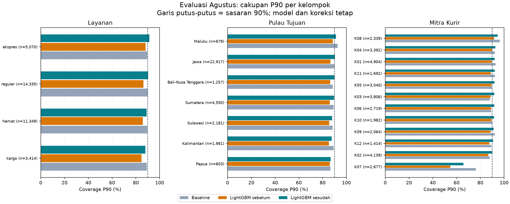
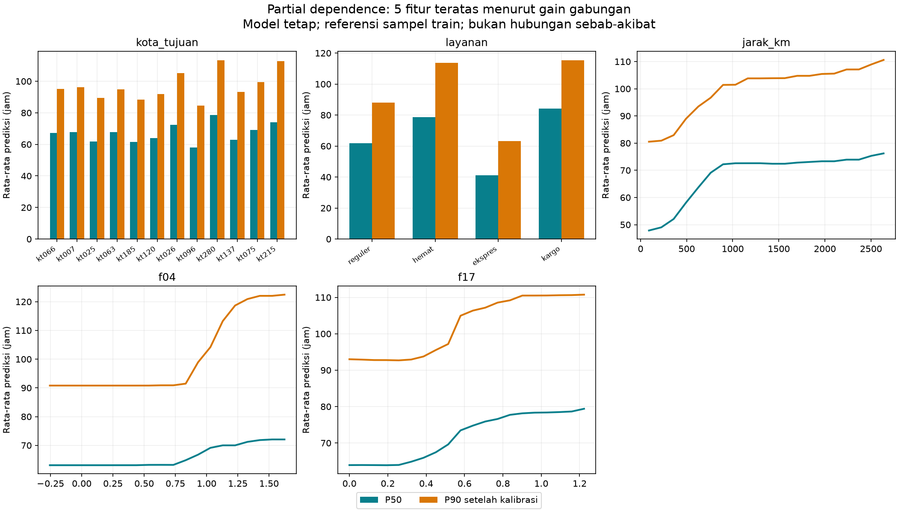

# Task 1: Estimasi waktu pengiriman paket

Draf bagian laporan untuk digabung dengan Task 2/3. Angka dihasilkan otomatis dari artefak eksperimen; belum merupakan laporan.pdf final kelompok atau klaim persetujuan anggota.

## Tujuan dan data

Memprediksi durasi_jam sebagai P50 dan batas atas P90 pada saat pickup. Tersedia 250,000 paket train dan 60,000 paket test. Train mencakup Januari–Agustus 2025, test September–Oktober 2025. Data eksternal tidak digunakan. ID hanya untuk identitas; dataset mentah tidak dikumpulkan ke GitHub.

## Audit kualitas dan ketersediaan fitur

| temuan | jumlah |
| --- | --- |
| berat kosong train | 13897 |
| berat kosong test | 3265 |
| durasi train >720 jam | 370 |
| perkiraan tiba melewati snapshot | 2804 |
| test dengan mitra baru | 2342 |

Kehilangan berat tidak seragam antar layanan. LightGBM menangani nilai kosong dengan indikator berat_kosong; Ridge mengisi median dari periode fit saja. Nilai ekstrem tidak otomatis dibuang. Kamus menyebut snapshot 31 Agustus, tetapi sebagian perkiraan tiba melewatinya. Waktu tiba dihitung sebagai pickup + durasi, sehingga kualitas timestamp/label menjadi keterbatasan.

Jumlah_scan dikecualikan karena waktu ketersediaannya belum jelas. Fitur f01–f50 dipertahankan karena kamus menyatakan dihitung saat pickup. Korelasi atau gain tinggi saja bukan bukti leakage. Eksperimen berikut memakai baris dan parameter yang sama, hanya menambah jumlah_scan:

| metrik | tanpa_scan | dengan_scan | penurunan_loss | penurunan_persen |
| --- | --- | --- | --- | --- |
| pinball_p50 | 10.092032 | 8.455126 | 1.636905 | 16.219781 |
| pinball_p90 | 9.749500 | 8.293575 | 1.455925 | 14.933333 |

Jika scan mencakup kejadian setelah pickup, manfaat tersebut memakai informasi masa depan. Namun eksperimen ini tidak memastikan mekanisme pencatatan; keputusan konservatif tetap tanpa scan. Sumber: [ringkasan audit](audit_regresi/ringkasan.json) dan [eksperimen scan](audit_leakage_regresi/metrik_per_fold.csv).

## Validasi dan pemilihan model

Baseline eksplorasi diuji dengan expanding window Juni–Agustus. Pada setiap cutoff, train hanya memakai pickup sebelumnya dan label yang diperkirakan sudah tersedia. Semua label periode validasi tetap dievaluasi. Perbandingan dengan KFold acak 3 fold, seed 42:

| skema | jumlah_validasi | pinball_p50 | coverage_p50 | pinball_p90 | coverage_p90 | mae_p50_jam |
| --- | --- | --- | --- | --- | --- | --- |
| acak | 250000 | 13.417489 | 0.501088 | 12.073362 | 0.900092 | 26.834979 |
| waktu | 100545 | 13.827183 | 0.501547 | 12.798527 | 0.898274 | 27.654365 |

Skor acak dan waktu memakai periode evaluasi, ukuran train, serta aturan kematangan label yang berbeda. Selisih tidak mengisolasi efek pengacakan. Skema waktu dipakai karena penggunaan nyata memprediksi bulan berikutnya. Tidak mengklaim skor acak pasti lebih baik untuk semua model.

Parameter model lanjutan dipilih pada Mei–Juni. Juli untuk kalibrasi; Agustus untuk evaluasi historis model tetap. Agustus sudah dilihat pada audit/baseline, sehingga bukan holdout yang sama sekali belum pernah dilihat. Pemilihan parameter sebelumnya memakai label Mei–Juni yang diberikan, termasuk sebagian yang mungkin belum tersedia pada cutoff Juli; ini bukan backtest operasional yang sepenuhnya bebas informasi masa depan.

Baseline menggunakan kuantil per layanan × pulau dengan fallback kuantil global train. LightGBM quantile memakai 200 pohon, learning rate 0,05, min_child_samples 100, reg_lambda 1, seed 42; num_leaves 15 dan 31 dibandingkan. Ridge memakai log1p target, alpha 1 dan 100, imputasi median, standardisasi dan one-hot hanya dari fit. Bulan terakhir sebelum validasi disisihkan untuk kuantil residual Ridge, tanpa refit sesudahnya. Karena itu ukuran fit Ridge lebih kecil; perbandingan merupakan perbandingan pipeline, bukan efek algoritme murni.

| model | jumlah_validasi | pinball_p50 | pinball_p90 | coverage_p90 | skor_pemilihan |
| --- | --- | --- | --- | --- | --- |
| baseline | 64782 | 12.962455 | 11.506339 | 0.906888 | 12.234397 |
| lgb_15 | 64782 | 10.087140 | 9.777672 | 0.921568 | 9.932406 |
| lgb_31 | 64782 | 10.092032 | 9.749500 | 0.917246 | 9.920766 |
| ridge_1 | 64782 | 10.549474 | 10.075569 | 0.927217 | 10.312521 |
| ridge_100 | 64782 | 10.592027 | 10.092081 | 0.927017 | 10.342054 |

Kriteria pemilihan adalah rata-rata pinball P50/P90 berbobot jumlah baris. Skor ini adalah skor pengembangan, bukan evaluasi independen. LightGBM 31 daun dipilih; dua konfigurasi LightGBM dihitung sebagai satu keluarga model, dan Ridge sebagai keluarga kedua.

## Ketahanan dan kategori baru

Encoder LightGBM belajar kategori dari train; unknown menjadi missing. Ridge menggabungkan kategori jarang (<50) dan menangani unknown melalui OneHotEncoder. Pada simulasi K01/K10 dikeluarkan dari train, semua paket validasi tetap diprediksi. Pengurangan data train dan perubahan komposisi juga memengaruhi hasil; satu simulasi tidak mewakili semua kategori baru.

| kondisi | subset | jumlah_validasi | pinball_p50 | pinball_p90 | coverage_p90 |
| --- | --- | --- | --- | --- | --- |
| asli | kurir_disembunyikan | 13099 | 10.742493 | 11.007173 | 0.918696 |
| asli | semua | 64782 | 10.092032 | 9.749500 | 0.917246 |
| cap_p99 | kurir_disembunyikan | 13099 | 10.738225 | 11.149992 | 0.917627 |
| cap_p99 | semua | 64782 | 10.089605 | 9.926397 | 0.914575 |
| kurir_baru | kurir_disembunyikan | 13099 | 11.152038 | 11.054647 | 0.925261 |
| kurir_baru | semua | 64782 | 10.234350 | 9.764050 | 0.918604 |

Cap target persentil 99 train memperburuk kriteria gabungan, sehingga target asli tetap dipakai setelah penyaringan kematangan label. Target validasi tidak dipotong. Sumber: [audit perlakuan](uji_ketahanan_regresi/audit_perlakuan.csv).

## Kalibrasi dan evaluasi historis Agustus

Skor kalibrasi adalah y−P90. Koreksi memakai statistik urut ke-ceil((n+1)×0,9), kemudian P90 dikoreksi dengan max(P90+koreksi,P50). P50 tidak dikalibrasi. Ini koreksi satu sisi bergaya split conformal; drift waktu dan seleksi label matang membatasi asumsi exchangeability, sehingga coverage 90% tidak dijamin.

Koreksi dari Juli: +4.592367 jam. Model tidak di-refit setelah koreksi.

| model | jumlah | pinball_p50 | coverage_p50 | pinball_p90 | coverage_p90 | mae_p50_jam |
| --- | --- | --- | --- | --- | --- | --- |
| baseline_tanpa_kalibrasi | 34168 | 14.075848 | 0.490927 | 13.288693 | 0.896277 | 28.151696 |
| lgb_sebelum | 34168 | 10.865726 | 0.474391 | 11.491574 | 0.863147 | 21.731452 |
| lgb_sesudah | 34168 | 10.865726 | 0.474391 | 11.406934 | 0.897624 | 21.731452 |

Baseline pada tabel ini juga memakai train sebelum Juli. Skor diagnostik Juli tidak dipresentasikan sebagai evaluasi independen. Parameter/koreksi tidak dipilih ulang berdasarkan Agustus.

## Analisis kesalahan per kelompok

| dimensi | kelompok | jumlah | pinball_p50 | pinball_p90 | coverage_p90 |
| --- | --- | --- | --- | --- | --- |
| layanan | hemat | 11349 | 14.328292 | 14.934790 | 0.890211 |
| layanan | kargo | 3414 | 11.655807 | 11.248770 | 0.879613 |
| layanan | reguler | 14335 | 9.780013 | 10.710554 | 0.902267 |
| pulau_tujuan | Sulawesi | 2181 | 26.761280 | 34.736958 | 0.879413 |
| pulau_tujuan | Kalimantan | 1981 | 24.198342 | 29.737335 | 0.875820 |
| pulau_tujuan | Maluku | 679 | 23.491935 | 25.788052 | 0.911635 |
| mitra_kurir | K06 | 2719 | 16.446563 | 21.680684 | 0.916513 |
| mitra_kurir | K07 | 2677 | 18.717546 | 18.976790 | 0.657826 |
| mitra_kurir | K02 | 4139 | 13.280046 | 15.244918 | 0.901184 |

Peringkat di atas berdasarkan rata-rata pinball P90, bukan jumlah kesalahan total. Dimensi dinilai terpisah. Coverage keseluruhan dapat menyembunyikan masalah suatu kelompok. K07 masih memiliki coverage P90 sekitar 65,78% sesudah koreksi. Temuan deskriptif ini tidak membuktikan penyebab operasional maupun perbedaan signifikan secara statistik.

| subset | jumlah | porsi_data_persen | kontribusi_error_absolut_p50_persen | kontribusi_loss_p90_persen | pinball_p50 | coverage_p50 | pinball_p90 | coverage_p90 | mae_p50_jam |
| --- | --- | --- | --- | --- | --- | --- | --- | --- | --- |
| durasi_sampai_720_jam | 34116 | 99.847811 | 64.017487 | 38.659351 | 6.966567 | 0.475114 | 4.416568 | 0.898992 | 13.933134 |
| durasi_di_atas_720_jam | 52 | 0.152189 | 35.982513 | 61.340649 | 2569.013844 | 0.000000 | 4597.624488 | 0.000000 | 5138.027689 |

Ambang 720 jam hanya untuk dekomposisi loss; seluruh 34.168 label Agustus tetap dinilai.

## Interpretasi partial dependence

Lima fitur dipilih dari rata-rata porsi gain P50/P90: kota_tujuan, layanan, jarak_km, f04, f17. Brute PDP memakai 2.000 baris train, seed 42. Grid numerik menggunakan persentil 5–95 (atau nilai unik jika sedikit); kategori hanya maksimal 12 teratas frekuensi train. Prediksi yang dijelaskan sudah melalui koreksi urutan kuantil dan kalibrasi P90.

Prediksi ekspres lebih pendek daripada reguler/hemat/kargo pada referensi yang sama; durasi umumnya meningkat seiring jarak pada rentang grid. F04/F17 tetap disebut fitur anonim. PDP bukan kausal dan bukan kuantil populasi; fitur berkorelasi dapat membentuk kombinasi hipotetis tidak realistis. Gain bukan SHAP atau bukti akurasi test. Lihat [catatan interpretasi](../catatan_interpretasi_regresi.md).

## Prediksi final dan keterbatasan

Model final memakai 212,489 baris fit sebelum Agustus dan 31,568 label Agustus matang untuk kalibrasi. Koreksi baru +0.218816 jam. Model tetap untuk Sep–Okt tanpa refit setelah kalibrasi. Output berisi 60,000 baris dengan kolom id_paket,p50,p90.

Agustus kini digunakan sebagai kalibrasi model final; skor evaluasi Agustus di atas berasal dari model historis sebelumnya. Saran refit seluruh train pada panduan tidak diikuti secara literal: sebagian data disisihkan agar koreksi sesuai model. Ini tradeoff jumlah data fit dengan pemisahan kalibrasi. Koreksi model lama tidak disalin ke model baru. Test dua bulan belum memiliki backtest dua bulan yang setara; skor/coverage test tidak diketahui. Prediksi diperiksa ID lengkap/unik, urutan sesuai test, finite, nonnegatif, serta P90≥P50 sebelum dan setelah serialisasi CSV.

## Reproduksi dan kontribusi

Dari root repository: `python kode/run_all.py --task 1 --data-dir "LOKASI_DATA"`. Gunakan Python 3.13.0 dan requirements-task1.txt. Seed 42 digunakan untuk prosedur acak. Output log, versi, fingerprint kode/input/hasil, serta status setiap tahap disimpan dalam hasil/reproduksi_task1. Task 2/3 belum diintegrasikan. Untuk ujian lisan, `python kode/baseline_regresi.py` mereproduksi angka baseline tanpa mengulang seluruh model.

Codex membantu menulis/debug skrip, menjalankan eksperimen, menyusun tabel/grafik dan draf. Validasi mencakup perhitungan manual, tes temporal, kategori baru, kesesuaian metrik agregat, dan pemeriksaan CSV. Anggota harus meninjau serta memahami kode dan mencatat bantuan AI secara jujur pada kontribusi.md; belum ada klaim persetujuan anggota atau PR pekerjaan ini.

## Referensi metode

- [LightGBM: categorical features](https://lightgbm.readthedocs.io/en/stable/Advanced-Topics.html)
- [scikit-learn: OneHotEncoder](https://scikit-learn.org/stable/modules/generated/sklearn.preprocessing.OneHotEncoder.html)
- [scikit-learn: partial dependence](https://scikit-learn.org/stable/modules/partial_dependence.html)
- [Angelopoulos dan Bates: pengantar conformal prediction](https://arxiv.org/abs/2107.07511)
