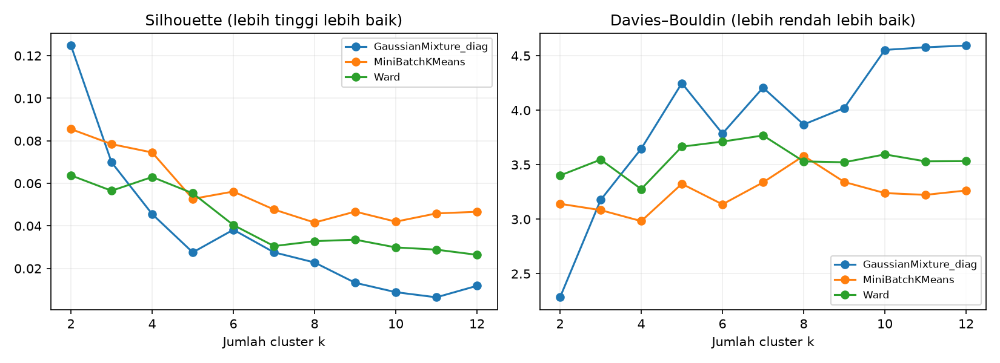

# Task 3 a-d — draf analisis

Audit seluruh 120.000 pelanggan; model dibandingkan pada sampel tetap. Tidak ada label referensi tersembunyi yang digunakan.

## a. Audit dan preprocessing

{"baris": 120000, "kolom": 60, "id_duplikat": 0, "baris_duplikat_tanpa_id": 0, "rasio_konversi_diatas_1": 656, "recency_diatas_90": 6655, "crm_di_luar_kamus": ["n11", "n12", "n13", "n14", "n15"]}

Imputasi median, winsorisasi 0,5–99,5 persen, log1p untuk numerik nonnegatif miring, standardisasi; komposisi memakai closure + akar kuadrat; kategori one-hot. Semua pelanggan dipertahankan. Winsorisasi tidak menetapkan label anomali.

Nilai recency >90 bukan otomatis salah karena pelanggan dapat lama tidak bertransaksi. Rasio konversi >1 dicatat sebagai anomali definisi/kualitas, tidak langsung dibuang. Detail tersimpan pada audit_kolom.csv dan parameter_preprocessing.csv.

## b. Fitur

ID dikeluarkan; n01–n15 hanya untuk ablation. n11–n15 tidak tercantum dalam kamus. Profil diberi bobot 0,25 per blok; perilaku dan kedua komposisi bobot 1. Korelasi >0,95 ditangani pada blok perilaku saja. Fitur dibuang: {'belanja_30h': 'belanja_90h'}

| metode | representasi | k | silhouette_acuan_utama | db_acuan_utama | ari_vs_utama |
| --- | --- | --- | --- | --- | --- |
| MiniBatchKMeans | utama | 2 | 0.08551 | 3.14177 | 1.0 |
| MiniBatchKMeans | tanpa_indikator_missing | 2 | 0.08702 | 3.11265 | 0.80817 |
| MiniBatchKMeans | tanpa_seleksi_korelasi | 2 | 0.0875 | 3.08957 | 0.69438 |
| MiniBatchKMeans | profil_bobot_1 | 2 | 0.07565 | 3.42482 | 0.40992 |
| MiniBatchKMeans | tambah_crm | 2 | 0.08618 | 3.04548 | 0.5544 |
| GaussianMixture_diag | utama | 2 | 0.12476 | 2.28387 | 1.0 |
| GaussianMixture_diag | tanpa_indikator_missing | 2 | 0.03829 | 5.21144 | 0.02651 |
| GaussianMixture_diag | tanpa_seleksi_korelasi | 2 | 0.12476 | 2.28387 | 1.0 |
| GaussianMixture_diag | profil_bobot_1 | 2 | 0.12476 | 2.28387 | 1.0 |
| GaussianMixture_diag | tambah_crm | 2 | 0.07819 | 3.4192 | 0.76903 |

Skor ablation memakai jarak acuan utama yang sama. ARI di sini sensitivitas fitur, bukan stabilitas resampling.

## c-d. Metode dan jumlah cluster

| metode | k | silhouette | davies_bouldin | calinski_harabasz | bic | konvergen | cluster_terkecil | cluster_terbesar | layak | rank_silhouette | rank_db | rank_rata |
| --- | --- | --- | --- | --- | --- | --- | --- | --- | --- | --- | --- | --- |
| MiniBatchKMeans | 2 | 0.08551 | 3.14177 | 592.76531 | nan | True | 2829 | 3171 | True | 2.0 | 5.0 | 3.5 |
| GaussianMixture_diag | 2 | 0.12476 | 2.28387 | 218.66712 | -73802.83569 | True | 324 | 5676 | True | 1.0 | 1.0 | 1.0 |
| Ward | 2 | 0.06374 | 3.4015 | 437.4001 | nan | True | 2008 | 3992 | True | 6.0 | 14.0 | 10.0 |
| MiniBatchKMeans | 3 | 0.07844 | 3.08396 | 499.2245 | nan | True | 1940 | 2048 | True | 3.0 | 3.0 | 3.0 |
| GaussianMixture_diag | 3 | 0.0699 | 3.17729 | 316.3245 | -92849.95299 | True | 324 | 3534 | True | 5.0 | 6.0 | 5.5 |
| Ward | 3 | 0.05653 | 3.5472 | 374.39662 | nan | True | 1521 | 2471 | True | 8.0 | 19.0 | 13.5 |
| MiniBatchKMeans | 4 | 0.07452 | 2.98309 | 423.01455 | nan | True | 1354 | 1745 | True | 4.0 | 2.0 | 3.0 |
| GaussianMixture_diag | 4 | 0.04556 | 3.64736 | 244.40868 | -131468.79042 | True | 324 | 2743 | True | 16.0 | 22.0 | 19.0 |
| Ward | 4 | 0.06299 | 3.27676 | 326.30552 | nan | True | 320 | 2151 | True | 7.0 | 10.0 | 8.5 |
| MiniBatchKMeans | 5 | 0.05271 | 3.32495 | 339.81748 | nan | True | 901 | 1556 | True | 11.0 | 11.0 | 11.0 |
| GaussianMixture_diag | 5 | 0.02756 | 4.24828 | 190.20977 | -138170.9084 | True | 324 | 2189 | True | 27.0 | 30.0 | 28.5 |
| Ward | 5 | 0.05534 | 3.66613 | 278.03763 | nan | True | 320 | 2008 | True | 10.0 | 23.0 | 16.5 |
| MiniBatchKMeans | 6 | 0.05616 | 3.13694 | 314.06949 | nan | True | 613 | 1350 | True | 9.0 | 4.0 | 6.5 |
| GaussianMixture_diag | 6 | 0.03821 | 3.78599 | 160.74396 | -234416.68178 | True | 86 | 2441 | True | 20.0 | 26.0 | 23.0 |
| Ward | 6 | 0.04042 | 3.71249 | 247.99324 | nan | True | 320 | 1521 | True | 19.0 | 24.0 | 21.5 |
| MiniBatchKMeans | 7 | 0.0477 | 3.33828 | 276.1185 | nan | True | 813 | 913 | True | 12.0 | 12.0 | 12.0 |
| GaussianMixture_diag | 7 | 0.02759 | 4.20747 | 134.81171 | -236608.3742 | True | 19 | 2467 | True | 26.0 | 29.0 | 27.5 |
| Ward | 7 | 0.03053 | 3.76858 | 226.34721 | nan | True | 320 | 1351 | True | 23.0 | 25.0 | 24.0 |
| MiniBatchKMeans | 8 | 0.04158 | 3.58174 | 246.85794 | nan | True | 602 | 874 | True | 18.0 | 20.0 | 19.0 |
| GaussianMixture_diag | 8 | 0.02281 | 3.86939 | 139.05739 | -240611.48325 | True | 86 | 2459 | True | 29.0 | 27.0 | 28.0 |
| Ward | 8 | 0.03283 | 3.53084 | 210.60538 | nan | True | 90 | 1351 | True | 22.0 | 16.0 | 19.0 |
| MiniBatchKMeans | 9 | 0.04673 | 3.34202 | 242.31138 | nan | True | 320 | 916 | True | 13.0 | 13.0 | 13.0 |
| GaussianMixture_diag | 9 | 0.01328 | 4.02063 | 124.43553 | -240861.93726 | True | 86 | 2473 | True | 30.0 | 28.0 | 29.0 |
| Ward | 9 | 0.03354 | 3.52283 | 197.22618 | nan | True | 90 | 1351 | True | 21.0 | 15.0 | 18.0 |
| MiniBatchKMeans | 10 | 0.04201 | 3.24003 | 219.40127 | nan | True | 424 | 931 | True | 17.0 | 8.0 | 12.5 |
| GaussianMixture_diag | 10 | 0.00886 | 4.55343 | 115.1895 | -286467.47856 | True | 99 | 962 | True | 32.0 | 31.0 | 31.5 |
| Ward | 10 | 0.0299 | 3.59514 | 185.91438 | nan | True | 90 | 923 | True | 24.0 | 21.0 | 22.5 |
| MiniBatchKMeans | 11 | 0.04587 | 3.22387 | 212.95791 | nan | True | 318 | 726 | True | 15.0 | 7.0 | 11.0 |
| GaussianMixture_diag | 11 | 0.00644 | 4.57757 | 103.05762 | -244406.14974 | True | 11 | 2434 | True | 33.0 | 32.0 | 32.5 |
| Ward | 11 | 0.02885 | 3.53132 | 175.32305 | nan | True | 90 | 923 | True | 25.0 | 17.0 | 21.0 |
| MiniBatchKMeans | 12 | 0.04665 | 3.26375 | 199.34867 | nan | True | 318 | 839 | True | 14.0 | 9.0 | 11.5 |
| GaussianMixture_diag | 12 | 0.01185 | 4.59351 | 93.67874 | -250147.50188 | True | 82 | 2411 | True | 31.0 | 33.0 | 32.0 |
| Ward | 12 | 0.02642 | 3.53317 | 165.40184 | nan | True | 90 | 755 | True | 28.0 | 18.0 | 23.0 |

Kandidat: GaussianMixture_diag, k=2. Pemilihan menggunakan rata-rata peringkat silhouette dan DB; CH dan BIC GMM menjadi diagnostik tambahan. BIC tidak dibandingkan antaralgoritme.

Ward memakai satu dendrogram untuk seluruh k; waktu per-k Ward di CSV hanya pemotongan pohon dan scoring, sehingga tidak boleh dibandingkan sebagai waktu training total antaralgoritme.

Kandidat berada di batas grid: True. Jika benar, rentang k perlu ditinjau sebelum kesimpulan final.

## Pemeriksaan artefak missing dan ketidaksepakatan k

| cluster_kandidat | jumlah | porsi_basket_missing | porsi_frekuensi_nol |
| --- | --- | --- | --- |
| 0 | 324 | 1.0 | 1.0 |
| 1 | 5676 | 0.0 | 0.0 |

Dua cluster kandidat memisahkan ada/tidaknya rata2_keranjang. Ini dapat mencerminkan tidak adanya transaksi, tetapi juga dipengaruhi indikator missing. Uji tanpa indikator tersedia pada ablation_fitur.csv. Jangan menyebut dua cluster ini jumlah segmen pemasaran sebenarnya sebelum bagian e-g.

BIC GMM paling kecil pada k=10, berbeda dari pilihan gabungan silhouette/DB bila nilainya tidak sama. Kriteria internal dapat bertentangan. Silhouette kandidat hanya 0.1248; struktur kelompok belum kuat.

Ablation dinilai pada ruang utama yang memang dirancang dengan pilihan fitur tersebut, sehingga tidak membuktikan fitur alternatif buruk atau tidak berguna. Bobot dan pemilihan fitur masih perlu ditinjau bersama.

## Keterbatasan dan kelanjutan

Preprocessing pada populasi penuh tanpa label; evaluasi deskriptif, bukan holdout.

Fit dan evaluasi metode memakai sampel yang sama; skor internal optimistis.

Belum stabilitas resampling, profil tindakan, atau penandaan anomali.

CRM anonim dikecualikan secara konservatif; bukan bukti semua fitur CRM tidak relevan.

Partisi sampel tidak boleh dikumpulkan sebagai cluster.csv final.

Tahap berikutnya e–g dilakukan bersama: stabilitas bootstrap/subsampling dengan ARI, profil/aksi pemasaran, dan aturan anomali -1. cluster.csv sementara dibuat dari kandidat a-d untuk integrasi, lalu harus diganti sebelum pengumpulan final.

## Reproduksi dan AI

Jalankan seluruh cell kode/Task3_Clustering.ipynb. Seed, versi, dan fingerprint input ada di keputusan_ad.json. Codex membantu menulis kode, tes pemeriksaan, eksperimen dan draf. Anggota wajib memeriksa hasil dan memahami keputusan.
